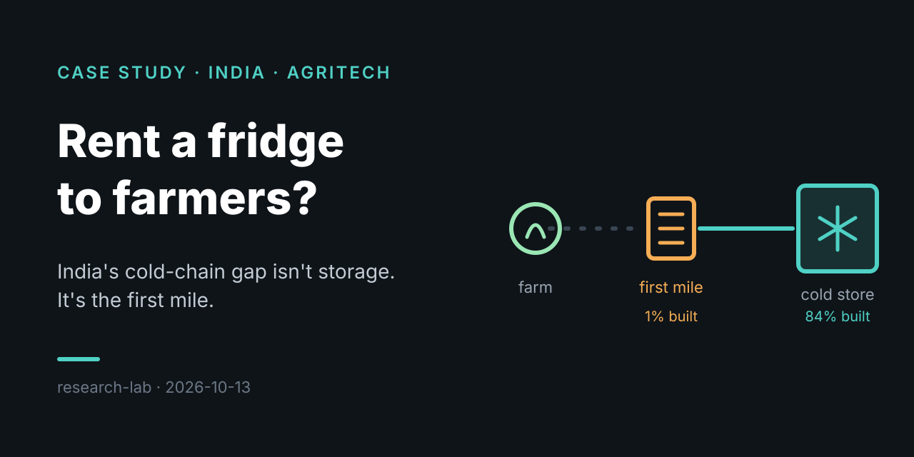
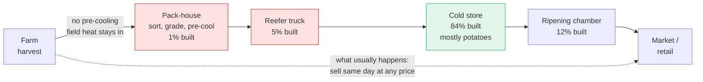
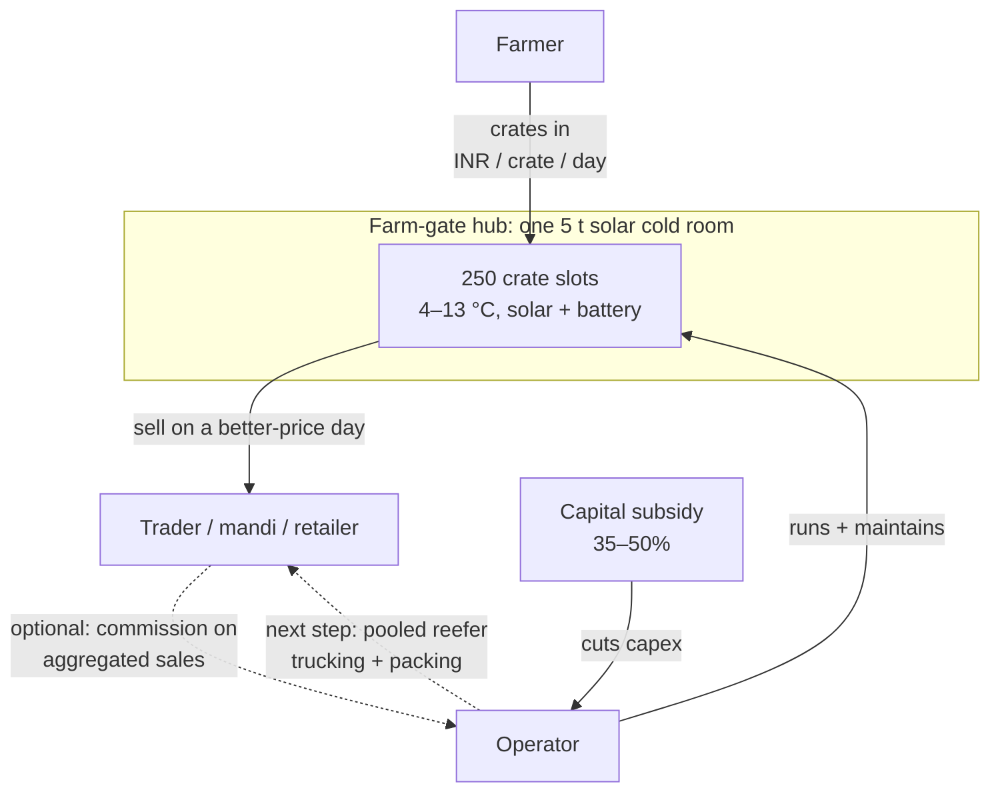

# Farm-gate cold rooms in India: is "rent a fridge to farmers" a business?

> **TL;DR:** India doesn't lack cold storage; it lacks the *first mile*: pack-houses, pre-cooling and refrigerated trucks between the farm and the cold store. A shared, pay-per-crate solar cold room fixes part of that, but on storage fees alone it barely pays back. The opportunity is to run the room as the entry point to a chain (aggregation, packing, trucking), not as a standalone fridge.

**Spark:** [@driftnav: "Startup ideas for every country (Part 12)"](https://www.instagram.com/reel/DeaqJsDRe29/) · **Angle:** case study + unit-economics model · **Date:** 2026-10-13

## The claim vs. reality

The reel (about one minute) argues: agriculture employs ~40% of India's workforce; a big share of fruit and vegetables is lost; the problem isn't a lack of cold storage (most of it holds potatoes) but missing refrigerated trucks and pack-houses; shared solar cold rooms at the farm gate (like Ecozen's Ecofrost) help, but financing, pack-houses, ripening chambers and reefer trucking are the real bottleneck.

| Claim in the reel | What the evidence says | Verdict |
|---|---|---|
| Agriculture employs ~40% of the workforce | PLFS 2023-24: **46.1%** of workers [14]. (A commenter read this "40%" as a food-loss figure; it isn't.) | ✅ Understated, if anything |
| On-screen table: losses of "40–50% of some crops" | The government-commissioned NABCONS 2022 study measured farm-to-market losses of **6–15% for fruits** and **5–12% for vegetables**; tomato 11.6%, guava 15.1% [1][2]. The 40–50% figure only appears when you stack retail and household waste on top, and the popular "40% of India's food is wasted" line has weak sourcing [13]. | ⚠️ Exaggerated for post-harvest loss |
| ~8,800 cold stores, ~40 million tonnes of capacity | Official count: **8,815 cold stores, 40.2 Mt** (June 2025) [4]. The reel's exact 8,831 / 40.29 Mt figures may be a later update; I couldn't verify them. | ✅ Right order of magnitude |
| Capacity is mostly potatoes | 68% of capacity is used for potatoes (Crisil, ~2019); older studies put it near 90% [6][7] | ✅ |
| Pack-houses, reefers and ripening chambers are the real gap | Against India Cooling Action Plan targets: cold storage **84%** built, ripening chambers **11.6%**, reefer vehicles **4.85%**, pack-houses **1.05%** [5] | ✅ Strongly supported |
| Ecozen already does rentable solar cold rooms | Ecofrost rooms are sold or leased; pay-per-crate service is run by partners like Oorja ("Oonnayan", Bihar) [8][10] | ✅ |

## How it works

Where produce gets stuck between the farm and the buyer, with how much of each piece of infrastructure India has built (percentages are progress toward national targets):



The farm-gate cold room tries to plug the first link. Here is how money moves in the shared, pay-per-crate model:



## Deep dive

### 1. The problem is the chain, not the cold store
India built cold-store capacity for one crop: potatoes. Potatoes are harvested once a year, stored for months in big single-commodity warehouses mostly in UP, West Bengal and Bihar, and need little else [6][7]. Fruits and vegetables need the opposite: pre-cooling within hours of harvest, short holds, mixed-commodity rooms, and a refrigerated ride to market. That's why an industry report can say cold storage is 84% of the way to target while pack-houses are at 1% and reefers under 5% [5]. India's own National Centre for Cold-chain Development reached the same conclusion years earlier: the gap "is not as much due to a lack of cold storage capacity" as to the links around it [15].

### 2. How big the loss really is
The honest number is smaller than the viral one but still huge. NABCONS (2022) estimates 7.4 Mt of fruit and 12.0 Mt of vegetables lost each year between farm and market [2], and ICRIER puts the cost of post-harvest losses across all agri-produce at about **INR 1.53 trillion (~$18.5 B) a year** [3]. Most fruit and veg loss happens *at the farm* (tomato: 8.4% at farm vs 3.3% at market [1]). That's exactly where a farm-gate cold room sits.

### 3. Who's already doing it
- **Ecozen (Ecofrost):** a 5–6 t solar cold room (5 kWp panels, ~36 h of thermal backup, 4–13 °C), INR 12–15 lakh installed [8]. More than 5,000 installs claimed by 2022, and Ashden reports up to 40% higher farmer profits [10].
- **Oorja "Oonnayan" (Bihar):** owns Ecofrost rooms at market gates and charges per crate per day. Farmers there buy a INR 1,000 membership card and then pay per crate [8][9].
- **Coolcrop (Gujarat):** usage-based on-farm solar cold rooms, with an app that tracks crates in and out and estimates remaining shelf life [11].
- **ColdHubs (Nigeria):** the same model at scale, with 50+ hubs at **100 naira (~INR 5) per 20 kg crate per day** [12]. That's the best public price benchmark, and the one my model uses.
- **Celcius (India):** works on the reefer side, helping small transporters own refrigerated vehicles [16]. That's the trucking link the reel says is underfunded.

### 4. Does the standalone room make money?
I modelled it (see **Apply it**). Short version: **no, not at farmer-friendly prices.** With a 35% subsidy, a 5 t room at INR 5/crate/day and 55% average occupancy makes ~INR 20k/yr operating profit on ~INR 9 lakh of net capex, so it never pays back. It needs about **INR 8.8/crate/day** at that occupancy, or 75%+ occupancy at INR 8, to clear a 12% cost of capital. Adding a 3% commission on produce sold through the hub helps but still doesn't close the gap.

That lines up with the reel's real point: **financing is the bottleneck**. The fridge alone is a thin business. It becomes a good one when the same hub also does the things India is missing: sorting and packing (the pack-house), pooled reefer pickups, and selling for the farmers.

## Apply it

[`code/cold_room_model.py`](code/cold_room_model.py) is a stdlib-only Python model of one shared 5-tonne room. Edit the `ASSUMPTIONS` dict and re-run:

```bash
python3 code/cold_room_model.py
```

Real output with the default assumptions:

```
Room: 5 t = 250 crates of 20 kg | net capex after 35% subsidy: INR 910,000

== Storage fees only
   revenue/yr INR 206,250  opex/yr INR 186,000  operating profit/yr INR 20,250
   10-yr NPV @ 12%: INR -871,578  payback: never (within 10 yrs)

== Storage + 3% aggregation commission
   revenue/yr INR 272,250  opex/yr INR 186,000  operating profit/yr INR 86,250
   10-yr NPV @ 12%: INR -498,663  payback: never (within 10 yrs)

Break-even storage tariff (fees only): INR 8.8/crate/day

10-yr NPV (INR lakh), storage fees only. Rows: tariff INR/crate/day, cols: avg occupancy
tariff        35%      55%      75%      90%
     3      -15.9    -13.4    -10.8     -8.9
     5      -13.0     -8.7     -4.5     -1.3
     8       -8.5     -1.7      5.1     10.1
    10       -5.5      2.9     11.4     17.8
    12       -2.6      7.6     17.8     25.4

Farmer view: one 20 kg crate of tomatoes at INR 15/kg (INR 300)
   store  3 days: fee INR 15 (5% of crate value); break-even price rise 0.0% after counting avoided farm loss
   store  7 days: fee INR 35 (12% of crate value); break-even price rise 3.3% after counting avoided farm loss
   store 14 days: fee INR 70 (23% of crate value); break-even price rise 15.0% after counting avoided farm loss
```

How to read it:
- **Occupancy matters as much as price.** Seasonal harvests leave rooms empty. A room that rotates crops (tomato → mango → grapes → flowers) at 75% occupancy works at INR 8; one sitting half-empty doesn't.
- **Farmers will pay for short holds.** For 3–7 days, avoided spoilage alone nearly covers the fee. Long holds of cheap produce don't work, so target high-value crops (grapes, pomegranate, flowers, exotic veg) or price by value, not by crate.
- Assumptions marked `(est.)` in the code are mine, not sourced. The tariff is the biggest unknown, since no Indian operator publishes per-crate rates.

## Takeaways
- Don't pitch "more cold storage" in India. Pitch the **first mile**: pre-cooling, packing and pooled reefer pickup next to the farm.
- A farm-gate cold room is a **customer-acquisition point**, not the whole business. Stack aggregation, grading and trucking on top of it.
- Lean on the **subsidy** (35–50%) and **multi-crop occupancy**; those two levers decide whether the unit works.
- Charge by **value and duration**, not a flat per-crate fee, so long holds of cheap produce don't scare farmers off.
- Treat the "40% of food is wasted" stat with care: farm-to-market losses for fruit and veg are 5–15% per crop. That's still a market worth billions of dollars a year.

## Open questions
- What do Indian per-crate operators actually charge, and what occupancy do they see? Talking to Oorja, Coolcrop or Ecozen would settle the model's biggest unknown.
- Can one operator profitably run a *cluster* of rooms plus one shared reefer truck? That's the next model to build.
- How much of the 46% of workers in agriculture grow perishables near a road a reefer could reach?

## Sources
1. [FreshPlaza: India reports high guava and tomato losses](https://www.freshplaza.com/asia/article/9756104/india-reports-high-guava-and-tomato-losses/): NABCONS 2022 crop-level losses
2. [Lok Sabha answer on post-harvest losses](https://eparlib.sansad.in/bitstream/123456789/2984698/1/AU1773_tyKJYF.pdf): category ranges and tonnage, NABCONS vs CIPHET
3. [ICRIER Policy Brief 20](https://icrier.org/pdf/Policy_Brief_20.pdf): INR 1.53 trillion annual post-harvest loss
4. [IIR: NCCD reports 2.2% CAGR in cold storage capacity](https://iifiir.org/en/news/india-nccd-reports-a-2-2-compound-annual-growth-rate-in-cold-storage-capacity): 8,815 stores / 402.18 lakh MT (June 2025)
5. [Grant Thornton Bharat: India's cold chain, from storage to a chain](https://www.grantthornton.in/insights/thought-leadership/indias-cold-chain-infrastructure-from-storage-to-a-chain/): progress vs India Cooling Action Plan targets, first-mile argument
6. [IBEF: Cold storage capacity expands](https://www.ibef.org/news/cold-storage-capacity-expands-rs-21000-crore-investment-lined-up-by-2023): 68% of capacity used for potatoes
7. [FoodNavigator: "India's cold chain only fit to store potatoes"](https://www.foodnavigator.com/Article/2014/04/28/India-s-cold-chain-only-fit-to-store-potatoes/): older ~90% estimate
8. [pv magazine India: Solar-powered cold storage as a service](https://www.pv-magazine-india.com/2021/06/07/solar-powered-cold-storage-as-a-service): Oonnayan model, INR 12–15 lakh per 5 t, 35–50% subsidy, specs
9. [Gaon Connection: Solar cold storage in Muzaffarpur](https://www.gaonconnection.com/english/bihar-cold-storage-facilities-post-harvest-losses-base-empa-muzaffarpur-fruits-vegetables-farmers-incomes-solar-51450/articleshow/124940405.html): INR 1,000 membership + per-crate pricing
10. [Ashden: Ecozen Solutions](https://www.ashden.org/winners/ecozen-solutions): farmer profit gains up to 40%
11. [Solar Impulse: CoolCrop Technologies](https://solarimpulse.com/companies/coolcrop-technologies-private-limited): usage-based on-farm solar cold storage
12. [IFPRI: ColdHubs in Nigeria](https://www.ifpri.org/blog/coldhubs-addressing-crucial-problem-food-loss-nigeria-solar-powered-refrigeration): pay-as-you-store benchmark
13. [Deccan Herald: The wastage myth](https://www.deccanherald.com/opinion/wastage-myth-2370989): on the weak sourcing of the "40% wasted" figure
14. [Rural World: Dominance of agriculture prevails](https://www.ruralworld.co.in/building-institutions-for-farmers/dominance-of-agriculture-prevails-in-indian-economy): PLFS 2023-24, 46.1% of workers in agriculture
15. [IIR: The need for cold storage and reefer vehicles in India](https://iifiir.org/en/news/the-need-for-cold-storage-and-reefer-vehicles-in-india): NCCD gap assessment, pack-houses and reefers
16. [YourStory: Celcius raises seed round](https://yourstory.com/2021/05/cold-chain-startup-celcius-raises-seed-round): reefer logistics for small transporters
